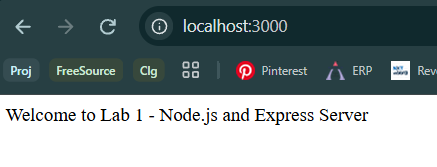
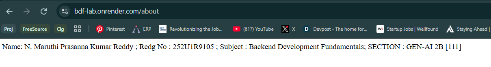
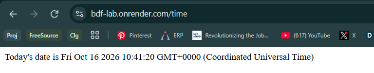
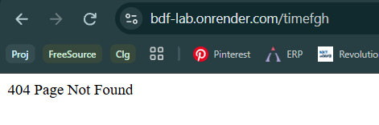

# Lab 1: Node.js and Express server

**Name:** N. Maruthi Prasanna Kumar Reddy  
**Registration Number:** 252U1R9105  
**Section:** GEN-AI 2B  
**Room:** 111  

**Live Link:** https://bdf-lab.onrender.com

---

## How to Run

1. Go into the project folder:
   ```bash
   cd Lab-01
   ```

2. Install the dependencies:
   ```bash
   npm install
   ```

3. Start the server:
   ```bash
   node index.js
   ```

4. Open the following URLs in the browser:
   - http://localhost:3000/
   - http://localhost:3000/about
   - http://localhost:3000/time

---

## Endpoints

| Method | Path     | Description                                      | Status Code |
|--------|----------|--------------------------------------------------|-------------|
| GET    | `/`      | Displays a welcome message                       | 200         |
| GET    | `/about` | Returns student details (Name, Reg No, Section)  | 200         |
| GET    | `/time`  | Returns the current date and time                | 200         |
| GET    | `/*`     | Handles all unknown routes                       | 404         |

---

## Screenshots

### Home Route (`/`)


### About Route (`/about`)


### Time Route (`/time`)


### 404 - Unknown Route


---

## Notes / Problems Faced

### 1. Handling Unknown Pages (404)

Initially, when a user visited a route that did not exist (for example `/xyz` or `/random`), the server did not return a proper 404 status. Instead, it either showed nothing or returned an incorrect response.

**Solution:**  
I added a catch-all middleware at the very end of the route definitions. This middleware catches any request that did not match the previous routes and sends a 404 response.

```js
app.use((req, res) => {
  res.status(404).send("404 - Page Not Found");
});
```

After adding this, unknown routes correctly returned status code **404**.

---

### 2. Deploying the Project on Render

While deploying the project on Render, I faced the following issues:

- The server was not starting after deployment.
- Dependencies were not being installed properly.
- The start command was incorrect.

**Solution:**

In the Render dashboard, I configured the following settings:

- **Build Command:** `npm install`
- **Start Command:** `node index.js`
- **Root Directory:** Left empty

After updating these settings and redeploying, the application started successfully and the live link began working.

---
