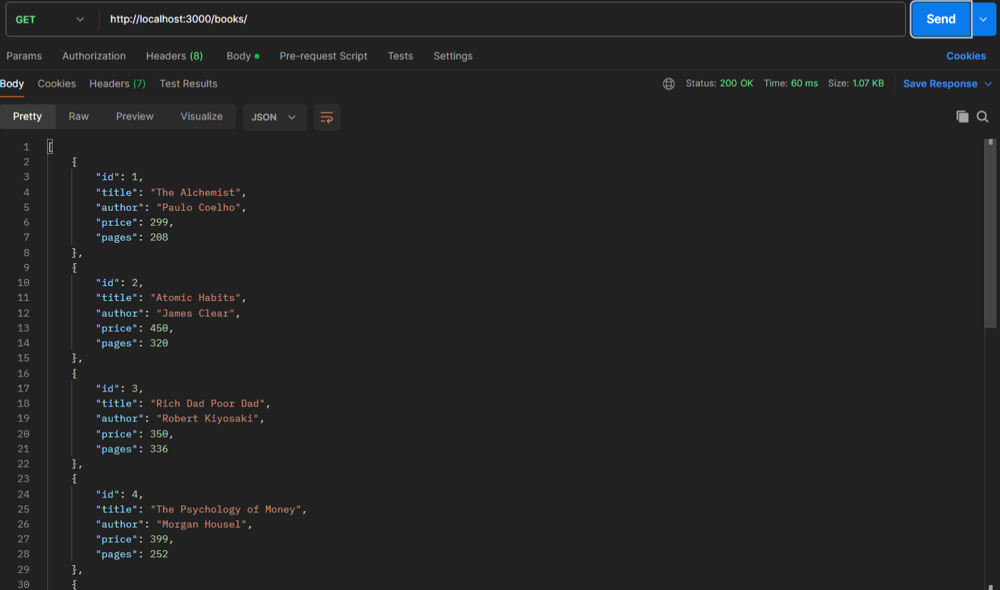
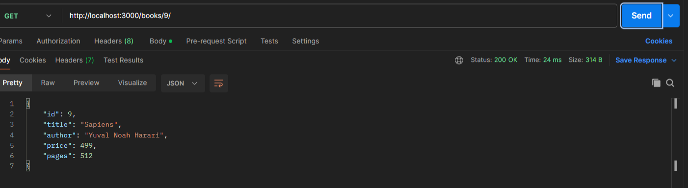
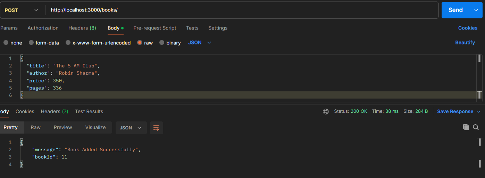
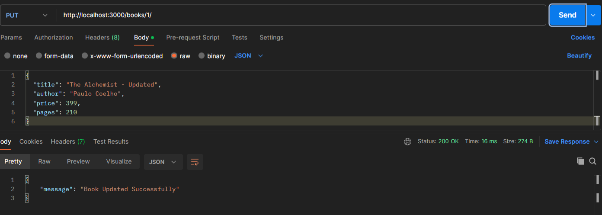
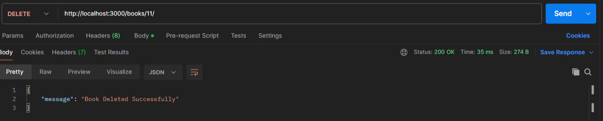
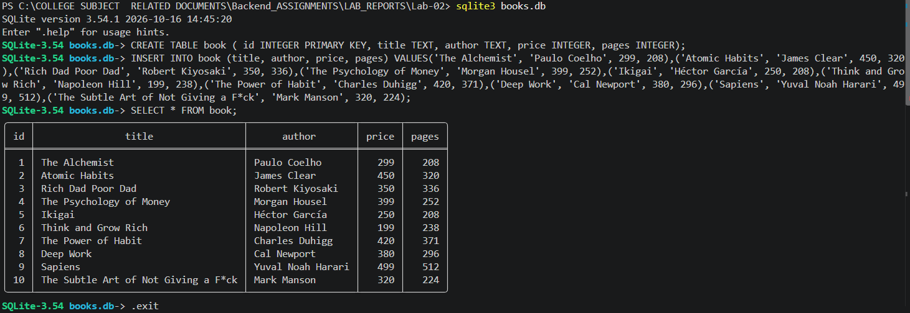

# Lab 2: SQLite database and CRUD routes

## Student Details

- **Name:** N. Maruthi Prasanna Kumar Reddy
- **Registration Number:** 252U1R9105
- **Section:** GEN-AI 2B
- **Room:** 111
- **Course:** Backend Development Fundamentals
- **Lab Number:** 02

## Live Link

**Deployment URL:** Not applicable (SQLite is a file-based database and is intended for local development)

## Objective

To connect an Express server to a SQLite database and expose full CRUD (Create, Read, Update, Delete) operations over HTTP using parameterized queries.

## Technologies Used

- Node.js
- Express.js
- SQLite (sqlite + sqlite3)
- Nodemon
- JavaScript
- npm
- Visual Studio Code
- Postman

## Project Structure

```text
Lab-02/
├── Screenshots/
│   ├── all-books.png
│   ├── single-book.png
│   ├── add-book.png
│   ├── update-book.png
│   ├── delete-book.png
│   └── sqlite-cli.png
├── books.db
├── index.js
├── package.json
├── package-lock.json
├── .gitignore
└── README.md
```

## Installation and Setup

### Prerequisites

- Node.js and npm installed
- SQLite command-line tools installed
- Visual Studio Code or another code editor
- Postman for testing the APIs

### Steps to Run

1. Clone the repository or download the project.
2. Open the `Lab-02` folder in the terminal.
3. Install the dependencies:

```bash
npm install
```

4. Start the server using nodemon:

```bash
nodemon index.js
```

5. Open Postman and test the endpoints listed below.

> No environment variables are required for this lab.

### Working with the SQLite Database

To inspect or modify the database manually:

```bash
sqlite3 books.db
```

Useful SQLite commands:

```sql
SELECT * FROM book;
.tables
.exit
```

## Endpoints

| Method | Endpoint          | Description                          | Expected Status |
|--------|-------------------|--------------------------------------|-----------------|
| GET    | `/books/`         | Returns all books                    | 200 OK          |
| GET    | `/books/:bookId/` | Returns a single book by ID          | 200 OK / 404    |
| POST   | `/books/`         | Adds a new book                      | 200 OK          |
| PUT    | `/books/:bookId/` | Updates an existing book             | 200 OK          |
| DELETE | `/books/:bookId/` | Deletes a book by ID                 | 200 OK          |

All queries that accept user input use `?` placeholders to prevent SQL injection.

## Screenshots

### 1. GET All Books

Displays the complete list of books from the database.



### 2. GET Single Book

Displays details of a single book using its ID.



### 3. POST – Add Book

Adds a new book to the database.



### 4. PUT – Update Book

Updates the details of an existing book.



### 5. DELETE – Delete Book

Deletes a book from the database.



### 6. SQLite CLI – Database View

Shows the current state of the `book` table after performing CRUD operations.



## HTTP Status Codes

- **200 OK:** The request was successful.
- **404 Not Found:** The requested book ID does not exist.

## Viva Questions

### 1. Why await the database call?

Database operations are asynchronous. Using `await` ensures that the code waits for the query to finish before sending the response, preventing incomplete or incorrect data from being returned.

### 2. What is SQL injection and how do placeholders prevent it?

SQL injection is an attack where malicious SQL code is inserted through user input. Using `?` placeholders separates the SQL query from the data, so user input is treated as values only and cannot alter the query structure.

### 3. When is PUT used instead of POST?

- **POST** is used to create a new resource (add a new book).
- **PUT** is used to update an existing resource (modify a book that already has an ID).

## Problems Faced and Solutions

### 1. SQLite CLI not recognized on Windows

The `sqlite3` command was not recognized in the terminal.  
**Solution:** Downloaded the official SQLite tools from sqlite.org, extracted them to `C:\sqlite`, added the folder to the system PATH, and restarted the terminal.

### 2. Testing and verifying CRUD operations

After implementing the routes, all five endpoints were tested in Postman. The results of POST, PUT, and DELETE operations were also verified by querying the database directly using the SQLite CLI (`SELECT * FROM book;`).

## Git and Repository Notes

- The `.gitignore` file excludes `node_modules/`, `.env`, and `desktop.ini`.
- The `node_modules/` directory must not be committed.
- Screenshots are stored in the `Screenshots/` directory.
- The project is submitted through the course GitHub repository under the `Lab-02` folder.
