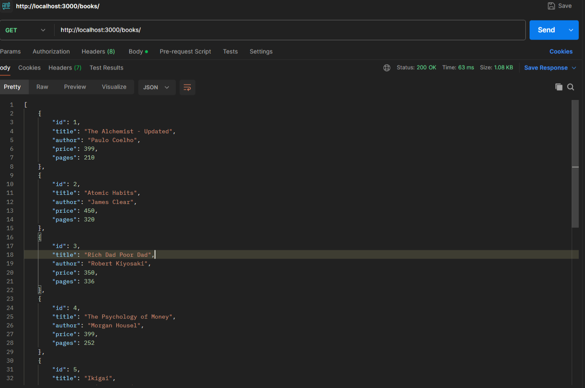
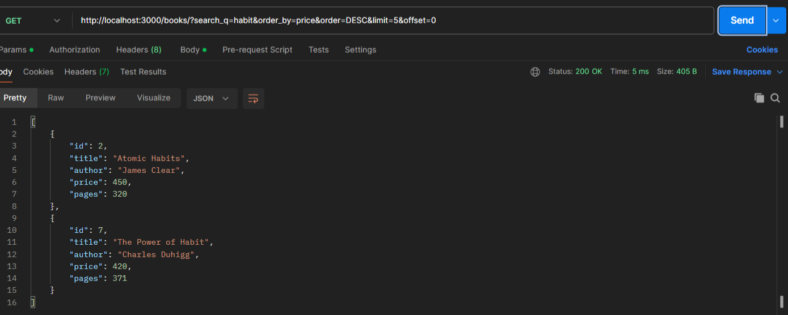
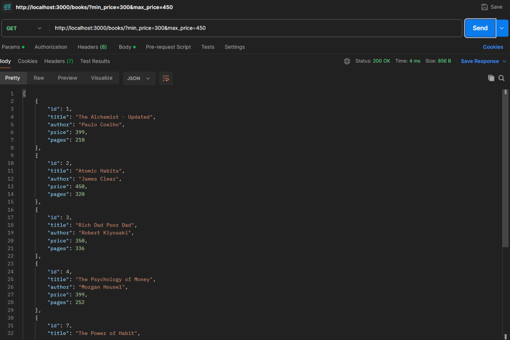
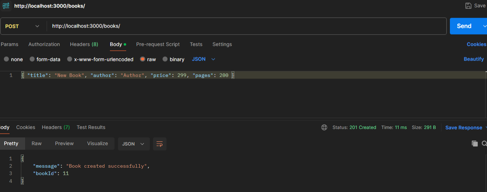
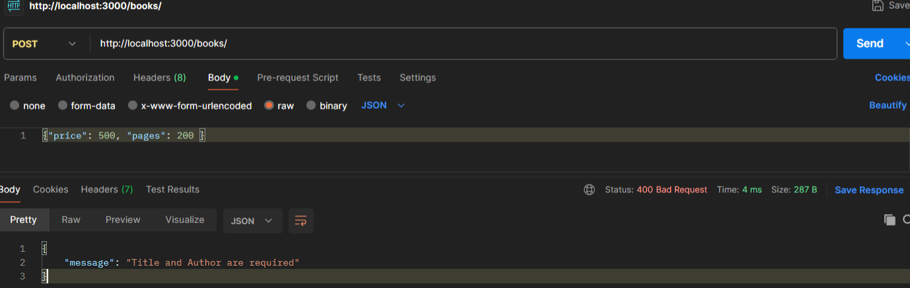
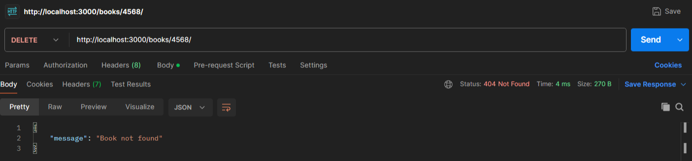
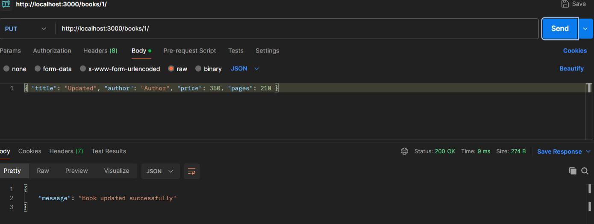
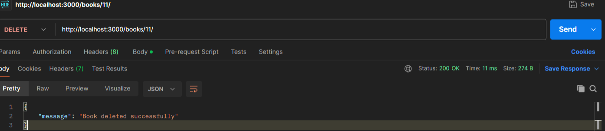

# Lab 3: REST API, query parameters, validation, debugging

## Student Details

- **Name:** N. Maruthi Prasanna Kumar Reddy
- **Registration Number:** 252U1R9105
- **Section:** GEN-AI 2B
- **Room:** 111
- **Course:** Backend Development Fundamentals
- **Lab Number:** 03

## Live Link

**Deployment URL:** https://bdf-lab-03-ltda.onrender.com

## Objective

To improve the Lab 2 routes into a clean REST API by adding search, sorting, pagination, price-range filtering, input validation, and correct HTTP status codes.

## Technologies Used

- Node.js
- Express.js
- SQLite3
- sqlite
- nodemon
- JavaScript
- npm
- Visual Studio Code
- Postman

## Project Structure

```text
Lab-03/
├── Screenshots/
│   ├── all-books.png
│   ├── search-books.png
│   ├── filter-price.png
│   ├── create-book.png
│   ├── validation-error.png
│   ├── not-found.png
│   ├── update-book.png
│   └── delete-book.png
├── books.db
├── index.js
├── package.json
├── package-lock.json
├── .gitignore
└── README.md
```

## Installation and Setup

### Prerequisites

- Node.js and npm installed
- SQLite command-line tools installed
- Visual Studio Code or another code editor
- Postman

### Steps to Run

1. Clone the repository or download the project.
2. Open the `Lab-03` folder in the terminal.
3. Install the dependencies:

```bash
npm install
```

4. Start the server using nodemon:

```bash
nodemon index.js
```

5. Open Postman and test the endpoints listed below.

> No environment variables are required for this lab.

### Working with the SQLite Database

To view or modify the database using the SQLite CLI:

```bash
sqlite3 books.db
```

Useful commands inside the SQLite prompt:

```sql
SELECT * FROM book;
.exit
```

## Endpoints

| Method | Endpoint          | Description                                               | Expected Status      |
|--------|-------------------|-----------------------------------------------------------|----------------------|
| GET    | `/books/`         | Get all books (supports search, sort, filter, pagination) | 200 OK               |
| GET    | `/books/:bookId/` | Get a single book by ID                                   | 200 OK / 404         |
| POST   | `/books/`         | Create a new book (with validation)                       | 201 Created / 400    |
| PUT    | `/books/:bookId/` | Update an existing book                                   | 200 OK / 404         |
| DELETE | `/books/:bookId/` | Delete a book                                             | 200 OK / 404         |

### Supported Query Parameters for GET `/books/`

| Parameter   | Description                        | Default   | Example                  |
|-------------|------------------------------------|-----------|--------------------------|
| `search_q`  | Partial title search (LIKE)        | `""`      | `?search_q=habit`        |
| `order_by`  | Column to sort by                  | `id`      | `?order_by=price`        |
| `order`     | Sort direction (ASC / DESC)        | `ASC`     | `?order=DESC`            |
| `limit`     | Number of records to return        | `10`      | `?limit=5`               |
| `offset`    | Number of records to skip          | `0`       | `?offset=5`              |
| `min_price` | Minimum price filter               | -         | `?min_price=300`         |
| `max_price` | Maximum price filter               | -         | `?max_price=450`         |

## Screenshots

### 1. GET All Books



### 2. Search Books (`search_q`)



### 3. Price Range Filter (`min_price` & `max_price`)



### 4. Create Book (201 Created)



### 5. Validation Error (400 Bad Request)



### 6. Book Not Found (404)



### 7. Update Book (200 OK)



### 8. Delete Book (200 OK)



## HTTP Status Codes

- **200 OK:** Successful GET, PUT, or DELETE
- **201 Created:** Successful POST (new book created)
- **400 Bad Request:** Validation failed (missing title/author or invalid price)
- **404 Not Found:** Book with the given ID does not exist

## Viva Questions

### 1. Query parameter vs path parameter?

- **Path parameter** is part of the URL path (example: `/books/5/`). It is used to identify a specific resource.
- **Query parameter** comes after `?` (example: `/books/?search_q=habit`). It is used for filtering, sorting, and pagination.

### 2. What does stateless mean?

In a REST API, every request is independent. The server does not store any client session data between requests. Each request must contain all the information needed to process it.

### 3. Which status code for bad input vs a missing record?

- **400 Bad Request** → Bad input / validation error
- **404 Not Found** → The requested resource (book ID) does not exist

## Problems Faced and Solutions

### 1. Correct status codes for different operations

Initially, create, update, and delete were all returning 200.  
**Solution:** Used `response.status(201)` for successful creation and kept 200 for update/delete. Added proper 404 checks before update and delete.

### 2. Input validation for POST request

Needed to reject requests with missing title/author or non-numeric price.  
**Solution:** Added simple validation checks at the beginning of the POST route and returned a clear JSON message with status 400.

### 3. Adding multiple query parameters

Combining search, sorting, limit, offset, and price filters in one query.  
**Solution:** Built the SQL query step by step by checking which query parameters were provided.

## Git and Repository Notes

- The `.gitignore` file excludes `node_modules/`, `.env`, and `desktop.ini`.
- The `node_modules/` directory must not be committed.
- Screenshots are stored in the `Screenshots/` directory.
- The project is submitted through the course GitHub repository under the `Lab-03` folder.
